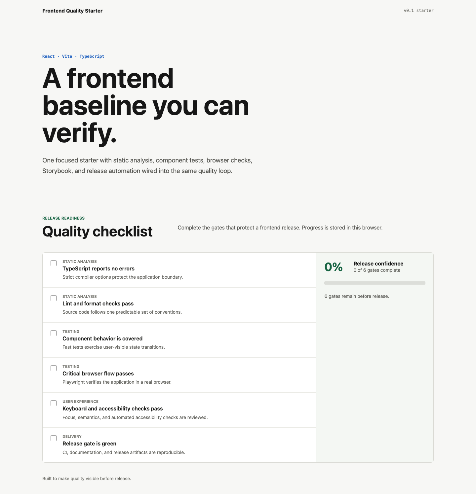

# Frontend Quality Starter

> Проверяемая основа React-приложения с единым quality loop от редактора до GitHub Release.

[](https://github.com/ddanshin94/frontend-quality-starter/actions/workflows/ci.yml)
[](LICENSE)

`frontend-quality-starter` связывает strict TypeScript, ESLint, Vitest, Storybook, Playwright и
GitHub Actions в один небольшой шаблон. Демонстрационный quality checklist показывает, где проходит
граница между component, story и browser tests.



## Быстрый старт

Требуются Node.js `24.18.0` и npm `11.16.0` или совместимые более новые версии. Browser policy:
последние две версии Chrome, Edge и Firefox, а также Safari 17+.

```bash
git clone https://github.com/ddanshin94/frontend-quality-starter.git
cd frontend-quality-starter
npm ci
npm run dev
```

Vite напечатает локальный URL. Откройте его и отметьте несколько quality gates: прогресс сохранится
в `localStorage` и восстановится после перезагрузки.

## Что уже подключено

- **Strict foundation** — React 19, Vite 8 и TypeScript 7 с project references.
- **Static gates** — ESLint 10 flat config, typed linting, JSX accessibility и Prettier.
- **Component confidence** — Vitest, Testing Library и V8 coverage без искусственного threshold.
- **Visible states** — Storybook с docs, controls, `addon-a11y` и четырьмя stories.
- **Browser gate** — Playwright проверяет pointer, keyboard, mobile layout и axe.
- **Delivery** — CI, release dry-run, трехбраузерный release matrix и GitHub Pages.

## Проверка проекта

```bash
npm run verify
npm run test:e2e:install
npm run test:e2e
```

`verify` последовательно запускает format check, lint, typecheck, component tests с coverage, сборку
приложения, статическую сборку Storybook и проверку документации. E2E остаётся отдельным gate,
поскольку требует установленный browser binary.

TypeScript 7 пока не предоставляет старый compiler API, который нужен `typescript-eslint`. Поэтому
пакет `typescript` в `devDependencies` указывает на `@typescript/typescript6` для lint tooling, а
alias `@typescript/native` предоставляет TypeScript 7. Команды `npm run typecheck` и `npm run build`
используют TypeScript 7 через `tsc`; проверить обе версии можно командами `npx tsc --version` и
`npx tsc6 --version`.

Для подробной диагностики включите структурированные DEBUG-сообщения:

```bash
LOG_LEVEL=DEBUG npm run verify
DEBUG=1 npm run test:e2e
```

Логи не выводят environment variables, tokens или authentication headers.

## Документация

| Руководство                              | Содержание                           |
| ---------------------------------------- | ------------------------------------ |
| [Начало работы](docs/getting-started.md) | Установка, команды и первая проверка |
| [Архитектура](docs/architecture.md)      | Границы модулей и поток зависимостей |
| [Тестирование](docs/testing.md)          | Роли Vitest, Storybook и Playwright  |
| [Поставка](docs/delivery.md)             | CI, Pages, release dry-run и выпуск  |

Правила участия находятся в [CONTRIBUTING.md](CONTRIBUTING.md), история изменений — в
[CHANGELOG.md](CHANGELOG.md).

## Использование как шаблона

После нажатия **Use this template**:

1. Замените `name`, `description` и version policy в `package.json`.
2. Обновите repository URLs, badges, Pages base path и release title.
3. Удалите или адаптируйте демонстрационный `quality-checklist` вместе с tests и stories.
4. Пересмотрите Node/browser policy и список quality gates под новый продукт.
5. Сбросьте `CHANGELOG.md` и `RELEASE_NOTES.md` перед первым собственным релизом.

GitHub-флаг **Template repository**, Pages и required checks включаются вручную в настройках
опубликованного репозитория.

## Ограничения

- Шаблон не заявляет production readiness или полное соответствие accessibility standards.
- Coverage публикуется как сигнал, но минимальный процент намеренно не навязывается.
- Обычный CI использует Chromium; Firefox и WebKit запускаются в release workflow.
- Router, API-layer и глобальный state manager не входят в scope `v0.1.0`.

## Лицензия

[MIT](LICENSE) © 2026 Dmitry Danshin.
